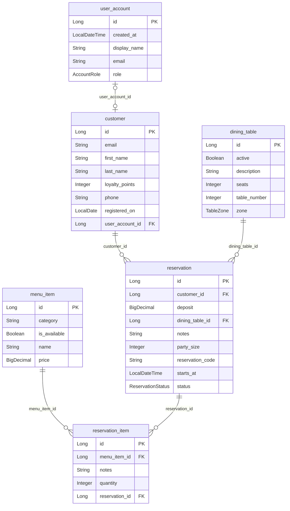

# Schemat bazy danych

Plik generują reguły projektu (panel Maven → Lifecycle → verify). Nie edytujcie go ręcznie.

Tabele: 6 · kolumny: 38 · relacje: 4 × @ManyToOne, 1 × @OneToMany, 1 × @OneToOne, 0 × @ManyToMany

| Tabela | Encja | Kolumny | Klucze obce |
|---|---|---|---|
| customer | Customer | 8 | user_account_id |
| dining_table | DiningTable | 6 | — |
| menu_item | MenuItem | 5 | — |
| reservation | Reservation | 9 | customer_id, dining_table_id |
| reservation_item | ReservationItem | 5 | menu_item_id, reservation_id |
| user_account | UserAccount | 5 | — |

